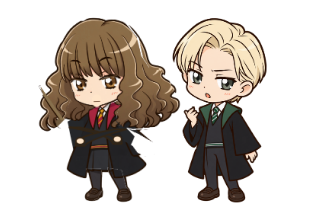
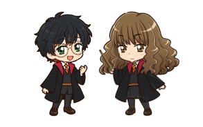

# Гермиона: автономия относительно фигуры и локальные сцены

## Аудит и исправление основы

Исходный pipeline сохранён: `SpriteLibrary` загружает готовые семь atlas states,
`AnimationController` отсчитывает кадры, `CollarPhysics` рассчитывает drag/reactions,
`PetLifeController` выбирает локальные сценки, `PetWindow` разрешает приоритеты,
рисует прозрачный кадр и обновляет native alpha mask. Сетевые инструменты к сценам
не подключаются; таймеры остаются тремя постоянными дочерними QTimer.

Найдены причины срывов:

1. `PetLifeController.update` брал минимум собственного idle и Windows
   GetLastInputInfo, а движение мыши сбрасывало автономию. Теперь Windows idle не
   используется. Совместимый параметр старого вызова игнорируется.
2. `PetWindow._tick` запрещал сцены при busy, открытой panel и активном основном
   окне. Эти условия удалены из figure-idle gate. Busy остаётся контекстом, а не
   запретом чтения параллельно расследованию.
3. `_sync_overlay_placement` каждые 250 мс сбрасывал life при работе в окне.
   Позиционирование отделено от активности; только старые offscreen travel actions
   завершаются при встраивании в dock.
4. Сигналы ввода и общего user_activity прерывали чтение. Они больше не подключены
   к figure interaction. События фигуры, её небольшой реакционной зоны, press/drag
   и контекстного меню сохраняют приоритет. Навигация/текст/скролл его не получают.
5. `_poll_cursor` самостоятельно переключал sprites, конкурируя с `_sync_activity`.
   Теперь он обновляет только измерения и вызывает общий arbiter.
6. Повторный happy/error в том же состоянии не перематывался после completed.
   Обязательные one-shots явно restart, их deadline соответствует длине atlas.
7. Hover выбирал неподвижный кадр по gaze: time-based blink/breath отсутствовали.
   Добавлен отдельный лёгкий time-based pass поверх исходного hover art.
8. Сохранение настроек из панели обновляло только cursor polling. Теперь оно
   применяет масштаб/FPS целиком, очищает старую crossfade-картинку и render cache.

Приоритет: drag/physics → обязательный короткий happy/error → life scene → busy
animation → hover/idle. Сетевой task при жизни фигуры не отменяется. Невидимый из-за
modal/dock overlay не растеризует кадры; clocks продолжают работать, при show
рисуется актуальный кадр. Во время сцены не создаются новые QTimer/потоки/сеть.

54 целевых regression tests прошли. Native source QA использует отдельные
APPDATA/IPC/vault namespaces и настоящий Qt/WebEngine. Проверяются набор черновика,
переключение страниц во время автономии, реальные hover/up/down gestures,
освобождение drag, изменение размеров и штатный выход. Ранний QA-прогон корректно
не прошёл, поскольку dock был свёрнут и production overlay был подавлен; драйвер
теперь открывает существующий dock штатной кнопкой. Код подавления не обходится.

Этап ремонта проверен и отправлен обычным push: `5b7e41b`, ветка
`granger/pet-life-scenes`.

## Сцены и расписание

`SCENES` в PetLifeController — единственный каталог больших сцен. Один action,
один started/duration; новая большая сцена не заменяет активную. Внутренние
settle/wake/return — явные прерывающие переходы. Начало и завершение определяются
monotonic clock, не цепочками setTimeout. Pose имеет enter/active/exit, strength,
progress и cameo actor. При позднем timer tick старые кадры не догоняются очередью.

| Сцена | Длительность | Минимальный figure idle | Собственный cooldown |
| --- | ---: | ---: | ---: |
| reading | 18 с | 35 с | 100 с |
| wand_play | 8 с | 45 с | 180 с |
| shy | 5.5 с | 45 с | 220 с |
| annoyed | 4.5 с | 45 с | 240 с |
| phone_solvnox | 13 с | 6 мин | 20 мин |
| daydream | 9 с | 8 мин | 25 мин |
| malfoy | 10 с | 5 мин | 30 мин |
| ron_chat | 8 с | 4 мин | 20 мин |
| ron_note | 9 с | 4 мин | 20 мин |
| harry | 8 с | 4 мин | 20 мин |

Между сценами случайная пауза 45–110 с, на старте 45–95 с. Предыдущая сцена
исключается из выбора. Общий cameo cooldown 12 минут, включая первые 12 минут
после старта. Во время busy-контекста вес чтения увеличен в 2.5 раза; выражения
смущения/возмущения и редкий спор менее вероятны. У телефона и мечтательной сцены
небольшие веса; это локальные статические сценарии, сообщений Solvnox не отправляют.
Старые cast/avada/travel/sleep handlers сохранены для совместимости, но новый
автоматический каталог выбирает эти десять сцен и не уводит фигуру за край окна.

## Рисование и персонажи

`scripts/build_pet_scene_assets.py` расширяет существующий Rig из
create_wand_animations. Исходный master и семь оригинальных atlas не заменяются.
512px layers сохраняются в assets/scenes; scene_art рисует руки/голову/ноги,
закрытие глаз, взгляд, книгу/перелистывание, палочку, телефон, typing/erase/retype,
румянец и маленькое сердечко. Растеризация ограничена 12 fps scene pose, без новых
ML dependencies. Нет тысячи заранее загруженных кадров; дополнительные PNG <1 МБ.

Малфой и Рон получены встроенным ImageGen с текущей Гермионой как стилевым эталоном.
Гарри — детерминированный производный мастер Рона после двух отклонений генератора:
та же форма тела/контуры, тёмные волосы, зелёные глаза, круглые очки и шрам.
Это явно различается в provenance; успешная AI-генерация Гарри не заявляется.
Полные prompts/способ сборки: [PROMPTS.md](../resources/cameo-masters/PROMPTS.md).

Все персонажи нормализованы к общему baseline и размеру. CameoWindow — ровно одно
дочернее прозрачное Tool window, без фокуса, WindowTransparentForInput и
WA_TransparentForMouseEvents. Оно не содержит чата, кнопок и собственных таймеров.
Рисунок ограничен текущим dock; окно исчезает после сцены, interrupt, hide и shutdown.
В узком dock могут немного перекрываться наружные края волос (не лица), максимум
10% размера. Масштаб не уменьшается. При недостатке места cameo исключается из
автоматического выбора. Исходная позиция не сохраняется со сдвигом сцены.

Native QA выявила также дублированный press во время захваченного drag: он мог
стереть collar identity, оставив physics.held без release. Повторный press теперь
игнорируется до завершения захвата; release освобождает реально held physics даже
при рассогласованном collar flag. Добавлен отдельный regression.

Проверки перед сборкой: полный backend — 1435 passed, 1 skipped (Ollama),
32 subtests passed, 266.99 с. После двух завершающих правок suppression/notification
отдельно прошёл весь набор персонажа: 71 passed, 38.68 с. Native source — 36/36:
все сцены, все три cameo, существующий dock 241 px и масштаб 195 px, interrupt,
реальный набор черновика и навигация, up/down drag, завершение/выход.
Проверены разные кадры 17 новых/старых actions. Виртуальное расписание охватило
трое суток, без наложения сцен, повторов подряд и нарушений cooldown.

Системное подавление невидимой фигуры больше не выдаётся за её касание: clocks
idle и ближайшая дата не сдвигаются на каждом hidden tick. Stationary hover по
фигуре, напротив, обновляет timestamp до конца реального hover. При завершении
сцены возвращается ранее существовавшая unread notification.

## Поставка и воспроизводимость

Файл `C:/Users/Admin/Desktop/Hermi_osint/dist/Granger-OSINT.exe`, Windows x64,
**277961699 байт**, SHA-256:

`4126f5ecdf9cadbe95765ca77c41b3950826a96b04027c5964f76b102f13f458`.

116 frozen Python-модулей соответствуют исходникам; 152 проверки ресурсов прошли.
Frontend, OSINT/GEOINT/DeepSeek компоненты не менялись. Старый EXE сохранён
в `dist/archive/before-pet-scenes-6d22ae13.exe`; промежуточный dd736 также сохранён.
Новые ассеты вместе занимают менее 1 МБ; дополнительных runtime/ML библиотек нет.

В коротком сопоставимом native idle: 195px, 24fps, cursor reaction off, workspace
скрыт, три интервала по 5 секунд. Медиана CPU дерева / всего компьютера:
6.242% одного ядра / 0.520% всей машины до;
5.929% / 0.494% после. Это небольшая вариативность, не доказательство ускорения.
Private commit дерева вырос с 214421504 до 234184704 байт (+18.85 МиБ).
RSS включает shared pages; это не private working set. GPU не измерялся.

Нативные парные кадры ниже получены в final EXE, с отдельной собственной прозрачной
фигурой и гостем, при фактическом положении окон. Это не макеты интерфейса:

Мастера: `grangerpet/assets/scenes/draco.png`, `harry.png`, `ron.png`.
Слои Гермионы — `hermione-*.png` в том же каталоге. Все production assets лежат
в проекте, а не только в `$CODEX_HOME/generated_images`. Генерация Draco/Ron —
встроенный ImageGen; Harry — описанный native derivative. Prompt set находится
в [PROMPTS.md](../resources/cameo-masters/PROMPTS.md).

Воспроизводимые команды: `scripts/build_pet_scene_assets.py`,
`scripts/qa_pet_life.py`, `scripts/preview_pet_scenes.py`,
`scripts/qa_pet_autonomy.py --exe dist/Granger-OSINT.exe --scenes --soak-seconds 300`.
Preview GIF строятся из production QPainter кадров; это renderer previews,
не запись экрана. Native QA проверяется отдельно. У reading/phone/malfoy
медиана построения 256px кадра/пары 1.83/2.00/1.90 мс, p95 2.32/2.39/2.16 мс.
Замер не включает compositor, маску окна и OS scheduling.

Исходники поставляются в `dist/Granger-OSINT-source.zip`, контрольные суммы —
`dist/Granger-OSINT.sha256` и `dist/Granger-OSINT-source.sha256`. ZIP не включает
профили, сессии, ключи, пользовательские фото, модели и raw QA logs/snapshots.

Commits кода: `5b7e41b` (ремонт), `a3d0ccb` (сцены/ассеты), `ad2d7a9` (home/scale).
Они отправлены обычным push в существующий репозиторий, ветка
`granger/pet-life-scenes`. Финальный commit документации/QA и совпадение remote
фиксируются в отдельном `dist/git-publication.json` и финальном ответе.

Завершающая регрессия воспроизвела сохранение временного cameo сдвига при открытии
основного окна: исходная desktop x=400 превращалась в x=428. `_dock_home` теперь
берётся из сохранённого CameoWindow.home, а не из текущего сдвинутого положения.
При изменении масштаба сохранённая home точка также учитывает высоту до ступней.
Неуспешный regression до исправления сохранён отдельно; EXE после этой правки
пересобран и проверен заново.

## Итоговая native-приёмка

Финальный EXE с hash выше прошёл **53/53** проверки. Сюда входят реальные hover,
up/down drag и release; typing и четыре страницы во время автономии; все десять
сцен; четыре cameo-сценария с тремя персонажами; нативный WS_EX_TRANSPARENT;
масштабы 100/160/195; minimize/maximize/close; сохранение исходной позиции при
открытии рабочего окна во время desktop cameo; выход и настоящий restart.

Длительный native-прогон — **300.01 с**, 161 замер. После чистого restart без
ускорения часов reading началось на 60.84-й секунде наблюдения, пока QA вводила
черновик в чате. Ни одного запроса в ИИ/OSINT и сообщения Solvnox не отправлено.
160 из 160 соседних видимых замеров меняли render signature. Дочерних QTimer
оставалось ровно **3**; после выхода и restart не осталось собственных процессов
или гостей. Многочасовой непрерывный Windows-прогон не заявляется.

Память в смешанном GUI-soak не объявляется полностью постоянной: суммарный private
commit вырос с 383.01 до 479.91 МиБ; у QtWebEngine renderer — с 39.99 до 152.20,
у основного EXE — с 291.20 до 327.71 МиБ. В последней половине минуты основной
процесс изменился примерно на 0.07 МиБ. Это измерение прогрева/переключения страниц,
не доказательство отсутствия всех утечек WebEngine. Отдельный профиль production
QPainter без WebEngine построил **10000 кадров** за 17.46 с: после первых 1000
private commit вырос на 94208 байт, со 2000-го до 10000-го оставался 110108672 байт.
Этот профиль не включает native mask/compositor.

Ранние failures сохранены: свёрнутый dock, слишком консервативная оценка ширины
cameo, duplicate press, home position, отказ ImageGen для Harry. Один soak перед
natural test принудительно проигрывал весь каталог и сохранял его cooldown —
драйвер исправлен на настоящий restart. Другой soak действительно показал чтение
и палочку, но имел неверную проверку числа уникальных кадров: atlas циклический.
В финальном прогоне проверяются соседние видимые состояния. Неуспешные отчёты не
переписаны в passed; приложение из-за этих последних QA-исправлений не менялось.

Проверка сохранности 27 защищённых файлов пользовательского профиля до/после EXE
QA: **27/27 hashes совпали**, содержимое не расшифровывалось. 12 исходных character
assets сохранены. Оригинальный Gansar Git clean; его код и ML runtime не менялись.

Агрегированные результаты: [release-summary.json](validation/pet-scenes/release-summary.json).
Сырые snapshots/профили/трейсы остаются только в исключённом `output/pet-scenes`.
Анимационный [preview Малфоя](validation/pet-scenes/malfoy.gif) воспроизводит
production QPainter кадры, а не выдается за запись экрана.

Основные файлы:

| Файл | Изменение |
| --- | --- |
| `grangerpet/pet.py` | Общий приоритет, figure events, повторный press, настройки/масштаб, home position |
| `grangerpet/pet_life.py` | Figure-relative clock, фазы, веса/cooldown/anti-repeat, запрет наложения |
| `grangerpet/animation.py`, `scene_art.py`, `pet_actions.py` | Загрузка слоёв, артикуляция и реквизит, time-based hover blink/breath |
| `grangerpet/pet_cameo.py` | Одно управляемое прозрачное гостевое окно и fitting по opaque bounds |
| `grangerpet/character.py` | Общий статус сцены, сохранение busy и unread notification |
| `grangerpet/app.py` | Защищённые QA hooks/status/snapshots; новых пользовательских элементов нет |
| `scripts/build_pet_scene_assets.py`, `preview_pet_scenes.py` | Воспроизводимая сборка и renderer previews |
| `scripts/qa_pet_autonomy.py`, `benchmark_pet_scene_idle.py`, `profile_pet_scene_renderer.py` | Native/soak/CPU/allocation проверки |
| `tests/test_pet*.py`, `test_character_controller.py` | Регрессии интеракта, часов, cooldown, позиционирования и кадров |
