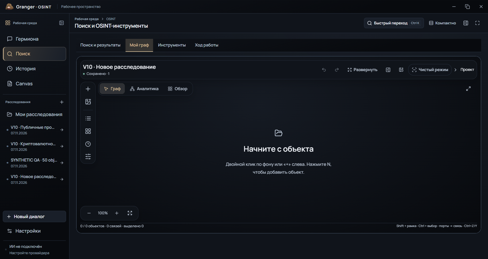
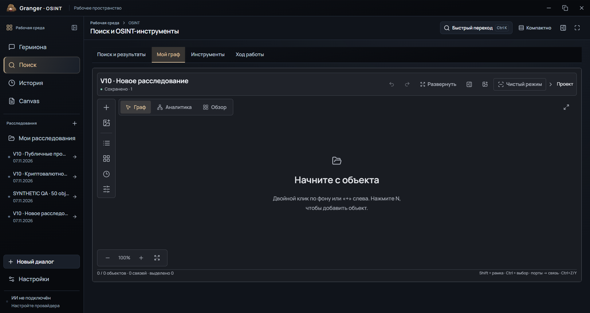
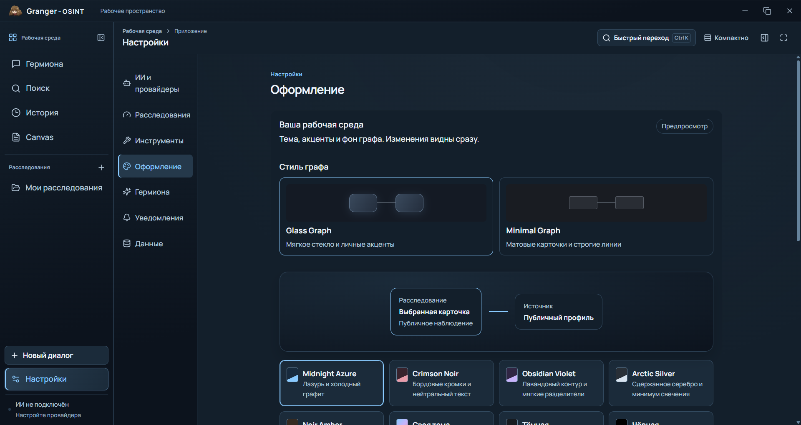

# Granger-OSINT · UI/UX Reconstruction V10

Изменения реализованы в существующей `main`, исходный HEAD
`10806a25f2b19a0b8b1e73817e18926d0c43f473`. Единственным исходным
пользовательским изменением был локальный `crypto_icon/`.

## A. Причины

В V9 позиции header, Clean, панели фильтров, инспектора и результатов
задавались независимо в нескольких CSS-файлах. Размещение зависело от
предполагаемой высоты соседей. При изменении размеров и открытии панелей
предположения переставали выполняться. У заголовка находок не было переноса,
а Escape у HTML disclosure не завершал открытый popup.

Контекстное меню находилось внутри stacking context сцены ниже инспектора.
Проверка реального частичного ответа Maigret выявила другую причину обрезки:
наследуемое `overflow:hidden` в теле результатов скрывало controls после
длинного сообщения источника, когда инспектор и результаты делили dock.
Тело результатов теперь прокручивается целиком, а header остаётся доступным.

Дополнительно обнаружена старая миграция saved search: при отсутствии метки
`semantic_network_v3` она сохраняла только закреплённые координаты. Эта
разрушающая миграция удалена; проверка выполняется на отдельном профиле.

## B. Поиск и результаты

Из внутренней навигации сохранённого результата удалена только вкладка
«Граф». Остаются «Обзор», «Дерево», «Доказательства» и существующее GEOINT
представление при наличии соответствующих данных. Старый `mode=graph`
открывает «Обзор». Сущности, связи, evidence, координаты и камеры не удаляются.
Основной «Мой граф», manual editor, fullscreen, экспорт и текстовый Canvas сохранены.

Переходы из обзора, Steam и GEO ведут в существующее дерево. Кнопка обзора
называется «Открыть дерево». Нативная проверка проходит этот переход, дожидается
реальных узлов дерева и сверяет сохранённые legacy координаты после Fit.

## C. Стили графа

`Настройки → Оформление → Стиль графа` содержит две миниатюры с live preview.
Glass и Minimal имеют отдельные `graphProfiles`; параметры проходят валидацию
в Python и сохраняются через существующее хранилище настроек. В расследование
параметры оформления не записываются. Аналитическая проекция остаётся отдельной
настройкой в фильтрах.

Glass использует тему и личные акценты, настраиваемую непрозрачность, тень,
скругления и деликатное стекло. Minimal по умолчанию использует непрозрачные
матовые поверхности, радиусы 4/6 px, компактные карточки и прямые нейтральные
линии. Blur, reflection, shadow и glow его профиля равны нулю.

## D. Минималистичное представление

Canvas2D действительно меняет геометрию карточек и размер аватаров, а не только
CSS рамки. Декоративные полосы карточек отключены. Обычные связи не получают
постоянных меток и стрелок. Настройка стрелок сохраняется отдельно для каждого
стиля и действует также на GPU edges. Направление исходной связи, суммы,
статус и происхождение остаются в данных и инспекторе. Явные размеры ручных
карточек имеют приоритет над автоматической плотностью.

## E. Криптоиконки

В исходной папке 23 файла: 18 изображений и 5 файлов описания/лицензий.
Manifest также ссылается на отсутствующий `tonkeeper.svg`. `cryptobot.png`
фактически является JPEG 32×32. Оригиналы не изменяются.

Реестр разделяет `network`, `asset`, `wallet`, `service`, `platform`, `generic`.
Bitcoin/Ethereum/TON/Dogecoin/Solana/Tron выбираются из типизированного поля
сети. Telegram не означает TON. Подпись адреса не превращается в сервисную
атрибуцию; сервисный логотип применим к типизированному объекту сервиса.

SVG проверяются по allowlist, viewBox, размеру, active attributes, external
references и CSS. В WebEngine передаются только PNG, полученные QtSvg в памяти.
PNG/JPEG проверяются по magic и размерам до декодирования. Aspect ratio
сохраняется. Есть bounded Python LRU и общий JS cache декодированных изображений;
на каждом кадре повторного декодирования нет. Слишком маленький оригинальный
растр при большом DPR заменяется векторным fallback вместо размытого логотипа.

Иконки используются в Canvas2D cards при обычном и semantic zoom, формах Gansar,
типизированных network selectors, инспекторе, аналитическом индексе,
карточках источников/результатов и описании Gansar в каталоге.

### Политика распространения

Папка остаётся локальной и исключена из Git и EXE. Причины: manifest покрывает
не все файлы; README не подтверждает свободное использование CryptoBot;
условия отдельных брендов ограничены; для OpenMask приложена GPL-3.0, но нет
полного подтверждения применимых исключений для распространения в составе
этого приложения. Отсутствие разрешения не заменяется предположением.
Документы пользователя сохранены. При отсутствии pack работают существующие
лицензированные Lucide glyphs.

Официальные источники условий: [Tether media](https://tether.to/en/media/),
[Bybit press](https://www.bybit.global/en/press),
[Lucide license](https://lucide.dev/license). Это не разрешение на свободное
распространение всего пользовательского набора. Полный локальный inventory
выполняет `scripts/audit_crypto_icons.py`; он не экспортирует изображения.

Локальный pack ищется в указанном корне инструментов и рядом с проектом
канонического `dist/Granger-OSINT.exe`, независимо от рабочей папки shortcut.

## F. Layout

`GraphLayout` владеет grid tracks для заголовка, навигации, command bar,
левой rail, правого dock и нижних controls. `ResizeObserver` и наблюдение за
составом панелей вычисляют safe zones, доступную высоту popup и место minimap.
Canvas сохраняет полный исходный прямоугольник при открытии dock: камера
и zoom от размеров панели не зависят. Инспектор и результаты делят один dock;
при недостатке высоты прокручиваются его содержимое и панели.

Clean находится в заголовке. `GraphCommandBar` объединяет поиск с очисткой,
тип, фильтры с индикатором и contextual layout selector. Контролы одной строки
используют общую высоту. При уменьшении ширины bar переходит на две строки.
Некритическое сообщение добавления исчезает через 9 секунд; событие остаётся
в истории расследования.

Слой контекстного меню принадлежит GraphLayout и располагается выше dock.
Меню ограничено размерами сцены, поддерживает клавиатуру и закрытие снаружи.
Изменение текста «Сохранено» не запускает повторную отрисовку safe zones:
координатор публикует событие только при изменении геометрии.

## G. Общие компоненты

`SearchableSelect` поддерживает типизированную иконку, сохраняя keyboard/Radix
поведение. `Details` закрывает popup через Escape с восстановлением фокуса;
внешний pointer закрывает только помеченные dismissible popup. Обычные
разделы со сведениями от внешнего клика не сворачиваются.
Заголовок результатов умеет переноситься и сохраняет кнопку закрытия.
Нативные select/checkbox/scrollbar и кириллица проверяются существующим
Windows harness, а не только jsdom.

## H. Производительность

Сохранён фактический V9 baseline EXE с SHA-256
`78e3b1d1b8b44c99593892df3e773e1e5a7f05353e6c0d3f280b52e6eb025c23`.
Измерены 50/100/500/1000/5000 синтетических узлов и отдельно прежние публичные
наблюдения Gansar/Maigret. Повторное использование наблюдений не считается
новым OSINT-поиском; renderer при этом может запрашивать публичные миниатюры.

Отчёт различает paint durations, event-to-paint от JS handler, полные интервалы
между paint с idle/IPC паузами и дополнительные активные интервалы. Ни один
из этих интервалов не объявляется FPS всей сессии. CPU содержит отдельную
нормализацию на одно ядро/всю машину; private commit не называется working set.
Измерения выполняются последовательно на AMD Ryzen 5 5600H (12 logical CPU),
Windows, системный DPR 1,25. Установлены AMD Radeon Graphics и RTX 3050 Laptop.
WDDM counters относятся к дереву проверяемого EXE; их суммы не означают
общую загрузку адаптера или уникально занятую физическую VRAM.

Полная последовательность без фоновой фотографии, **p50 / p95 paint, мс**:

| Узлы | V9 Glass | V10 Glass | V10 Minimal |
| ---: | ---: | ---: | ---: |
| 50 | 2,7 / 4,5 | 2,9 / 5,6 | 2,2 / 3,3 |
| 100 | 3,1 / 4,6 | 3,2 / 4,4 | 2,3 / 3,3 |
| 500 | 3,6 / 6,2 | 3,8 / 7,0 | 2,4 / 5,6 |
| 1000 | 4,0 / 8,1 | 4,1 / 8,8 | 2,7 / 6,3 |
| 5000 | 4,6 / 31,5 | 4,9 / 50,7 | 2,8 / 7,1 |

Отдельные прежние публичные наблюдения: 424 узла Gansar дали
1,45/2,6 → 1,55/2,5 → 0,8/1,3 мс; 14 узлов Maigret —
0,6/0,8 → 0,6/0,9 → 0,5/0,9 мс (V9 / V10 Glass / Minimal).
Эти результаты не выдаются за новый сетевой поиск.

Фоны и эффекты, 500 узлов, **p50 / p95 paint, мс**:

| Сценарий | V9 Glass | V10 Glass | V10 Minimal |
| --- | ---: | ---: | ---: |
| 1080p Auto | 4,3 / 8,3 | 4,4 / 11,1 | 2,8 / 6,4 |
| 4K Auto | 4,0 / 9,0 | 4,05 / 8,1 | 3,0 / 6,3 |
| 4K Original, blur 12, glow 18 | 3,9 / 8,1 | 4,2 / 10,9 | 2,8 / 6,6 |
| Без эффектов | 4,5 / 7,6 | 4,4 / 7,0 | 2,95 / 6,0 |

Одна предоставленная фотография пересэмплирована в 1920×1080 и 3840×2160;
версии получают одинаковые байты. Это проверяет стоимость декодирования
этих размеров, не наличие исходной фотографической детализации 4K. Исходник
не изменён; производные остаются в приватной QA-папке.

При обычном масштабе карточки вне viewport отсекаются: в зафиксированном
состоянии 5000 узлов на экране 13 карточек. Fit использует semantic overview
(37 представлений, 34 на экране), сохраняя 5000 исходных объектов в модели.
Это не заявление о рисовании 5000 полных карточек одновременно.

В полной последовательности на 5000 узлах CPU всей машины составил
10,45/10,93/10,63%, private commit — 1779,6/1802,6/1544,7 MiB.
Уменьшение CPU для Glass не подтверждено. JS-handler-to-paint p95 —
18,8/68,2/33,3 мс; end-to-save создания связи — 1,266/1,194/1,236 с,
включая транспорт и ожидания QA. OS input-to-present latency не измерялась.

Полный прогон показывает меньшую стоимость рисования Minimal. Из-за tail Glass
выполнены три дополнительные чередующиеся пары, каждая с отдельным профилем
и только 5000 узлами. Они отделены от полной последовательности:

| Повтор | V9 paint p50/p95, мс | V10 Glass paint p50/p95, мс | V9 / V10 JS-handler-to-paint p95, мс |
| ---: | ---: | ---: | ---: |
| 1 | 5,6 / 13,4 | 6,0 / 16,0 | 19,9 / 19,9 |
| 2 | 6,2 / 14,6 | 6,25 / 13,5 | 18,3 / 86,8 |
| 3 | 4,85 / 16,9 | 4,7 / 13,8 | 67,8 / 17,3 |

Диапазоны повторов перекрываются; постоянное замедление Glass не подтверждено,
но повышенный tail полной последовательности и отдельные задержки остаются
в отчёте. Ускорение Glass, уменьшение его CPU и стабильные 60 FPS не заявляются. Все 15 сценариев проверили
создание связи перетаскиванием порта и Undo; сохранённые позиции пережили
шесть раскладок, поиск и Fit.

Первый нагрузочный заход остановился по deadline ожидания очереди на 50
узлах; он не включён в успешную матрицу. Отдельный повтор 50 и последующая
полная матрица прошли. Harness теперь ждёт очередь также перед первым
QA-open и сохраняет диагностическое состояние при ошибке. Причина первого
тайм-аута не установлена; это не называется доказанным исправлением приложения.

## I. Native QA

`scripts/qa_graph_v10.py` запускает отдельный профиль, IPC namespace и vault.
Реальные Qt input events проверяют стили, сохранение, перезапуск, Clean,
expanded/native fullscreen, инспектор, результаты и saved search.
`qa_graph_geometry.py` считывает фиксированный набор DOM-прямоугольников,
ищет пересечения controls и панелей, горизонтальную обрезку, высоту command
controls и выход popup за viewport. Намеренные popup поверх сцены исключены
из проверки столкновений.

100/150/200% проверяются через Qt scale factor поверх неизменённого Windows
DPI; в каждом случае записывается реальный WebEngine DPR. Фактический
системный масштаб этой машины — 125%. Эмуляция не выдаётся за смену Windows DPI.
Снимки с локальными логотипами сохраняются локально, без публикации pack
через производные изображения в Git.

На окончательном EXE выполнены 115 базовых проверок, 3 проверки saved search
и 293 проверки матрицы: 4 размера × 4 DPR × 2 стиля × inspector open/closed.
Все 64 снимка матрицы просмотрены. Дополнительно просмотрены 29 снимков
базового сценария и saved search этого же EXE.

Сценарии контекстного меню, всех семи категорий настроек, 16 вариантов обоев,
20 форм объектов в каждом стиле и живые поиски выполнены на непосредственно
предыдущем кандидате. Их receipts сохраняют настоящий SHA того EXE. После
них исправлены только два TSX-компонента навигации saved search и assertion
теста. Сверка исходников подтверждает неизменность renderer, layout, settings,
icons и всех Python-модулей. Этот охват не подменяется утверждением, что каждый
предыдущий сценарий повторно запускался на окончательном файле.

## J. Регрессии

Окончательный последовательный Python прогон: **2129 passed, 2 skipped,
32 subtests passed**, 358,95 с. Первый полный прогон до последнего build-test
давал 2128 passed. В промежуточном запуске одновременно со сборкой один
существующий chat deadline-test превысил 3 секунды; целевой повтор 49 tests
и окончательный полный запуск без параллельной нагрузки прошли.
Окончательный frontend: **239 passed**, 41 test file, 48,06 с. Проверка
перехода «Открыть дерево» входит в этот прогон.
Отдельно выполнен реальный HTTPS DeepSeek V4 Flash: ответ получен, проверочный
`tool_calls` прошёл round trip. Проба не запускала OSINT-инструменты.
Системная инструкция, маршрутизация, секреты, персонаж и его runtime не менялись.

Живой Maigret quick вернул 3 записи и честный `partial/tool_execution_failed`;
отдельный GitHub profile — 3 записи, `complete`, с ограничением публичной
выборки. Репозиторий добавлен в Identity и сохранён после перезапуска.
Свежий Gansar profile вернул 236 наблюдений: 10 providers, 51 HTTP request,
`partial/worker_response_limit`. Ошибки 429/404/500/502 не скрыты и не заменены
ложным полным результатом. Сохранение, выделение и добавление наблюдений
проверены в обоих стилях. Эти живые receipts относятся к предыдущему
навигационному кандидату, как описано в I.

## K. Сохранность

Перед работой создан приватный снимок контрольных сумм artwork, resources,
пользовательского pack и профиля. Проверки интерфейса используют отдельные
профили. Перед закрытием рабочего приложения повторно совпали все 1474 файла:
92 artwork, 202 resources, 23 файла пользовательского pack, 1157 файлов профиля.
Дополнительно совпали 2 pet runtimes и 508 исходных файлов внешних инструментов
с сохранёнными контрольными суммами, также проверенными при поставке V9.

Сохранена приватная побайтовая копия 1157 файлов профиля. Изменённые файлы
пользователя не откатываются; ciphertext не расшифровывается ради сравнения.
После обычного закрытия относительно исходного снимка удалились 2 файла
блокировки и изменились байты 3 файлов профиля. Обе приватные копии сохранены;
смысловые изменения содержимого по одним хешам не утверждаются, откат не выполнен.
Оставшийся процесс питомца завершён существующей штатной IPC-командой после
подтверждения закрытия пользователем, без force termination.

Перед заменой EXE после закрытия снят отдельный baseline из 1155 файлов.
Установка и smoke сохранили все 1155: **0 added, 0 missing, 0 changed**.
Агрегаты включены в
[`preservation.json`](validation/ui-v10/preservation.json).

## L. GitHub

Ветка и default branch: `main`. Автор: существующие `Zakhar / Watson@mail.ru`.
GitHub API возвращает `403: account suspended`, поэтому соответствие email
аккаунту и Contributions подтвердить нельзя. Авторство и timestamps не меняются.
Обычный `git push origin main` завершился с кодом 0. Изменения V10:
[`54a4624b3d5a1f7290c0bb2aa9363ff4b5907fd6`](https://github.com/watsoncore/Granger-OSINT/commit/54a4624b3d5a1f7290c0bb2aa9363ff4b5907fd6).
`git ls-remote --symref origin HEAD refs/heads/main` подтвердил тот же SHA
для удалённых main и HEAD. REST API после успешного push повторно вернул 403;
это ограничение не обходилось. Результат проверки:
[`git.json`](validation/ui-v10/git.json). Receipt установки и этот отчёт
публикуются следующим содержательным documentation commit.

## M. Сборка

Действующий pipeline заново собирает frontend, сверяет входной fingerprint,
замороженные Python-модули и ресурсы. Fingerprint учитывает generator scripts,
но исключает генерируемые `.tsbuildinfo` и license notice: они не являются
исходными входами. Сам notice проверяется как упакованный ресурс.
Неуспешная компиляция останавливает также source QA. Первый не прошедший smoke
кандидат не установлен; диагностика запуска теперь сохраняется до очистки
временной сборочной папки.

Финальный проверенный файл: **279 665 710 bytes**, SHA-256
`10d091ecf2000619bcfa8f5646ee8f2effb2141e34d742c4389bbe84aaa62026`.
Сверены 173 frozen Python modules, 239 resource checks и 22 core native checks.
Frontend input fingerprint:
`502e9b3f44d98af13ff685155a1dbbcd79282e748d3a97ab67a22aa91bea02a5`.
Gansar и Maigret проходят strict availability в действующих локальных runtimes.
Файл установлен в `dist/Granger-OSINT.exe`; после замены прошли ещё 22
core native checks именно канонического EXE. В `dist` один этот EXE,
временная сборочная папка удалена. Первый вызов установки был остановлен
защитой из-за оставшегося питомца и не заменял файл. После штатного выхода
повторная установка завершилась успешно. Результат записан в
[`canonical-smoke.json`](validation/ui-v10/canonical-smoke.json),
[`release.json`](validation/ui-v10/release.json) и
[`preservation.json`](validation/ui-v10/preservation.json).

## N. Ограничения

- Исходные криптоиконки остаются локальными по причинам лицензирования.
- Отсутствующий Tonkeeper и недостаточный native raster size используют fallback.
- Масштабы, отличные от системного 125%, эмулируются Qt.
- GitHub Contributions не подтверждены из-за ограничения REST API аккаунта.
- На 5000 узлах остаются отдельные всплески задержек; постоянные 60 FPS и
  ускорение Glass не подтверждены. Результаты полной серии и всех повторов сохранены.
- Живые Gansar/Maigret вернули частичные результаты с указанными выше ограничениями.
- Два Python-теста пропущены; это не объявляется успешным выполнением этих тестов.

Проверяемые материалы: [native](validation/ui-v10/native.json),
[производительность](validation/ui-v10/performance.json),
[тесты](validation/ui-v10/tests.json), [DeepSeek](validation/ui-v10/deepseek.json),
[иконки](validation/ui-v10/crypto-icons.json),
[безопасность](validation/ui-v10/security.json),
[реестр 192 просмотренных снимков](validation/ui-v10/screenshots.json).
Снимки performance содержат детерминированные seed-позиции; наложение самих
узлов в таком seed не является доказательством перекрытия панелей интерфейса.

