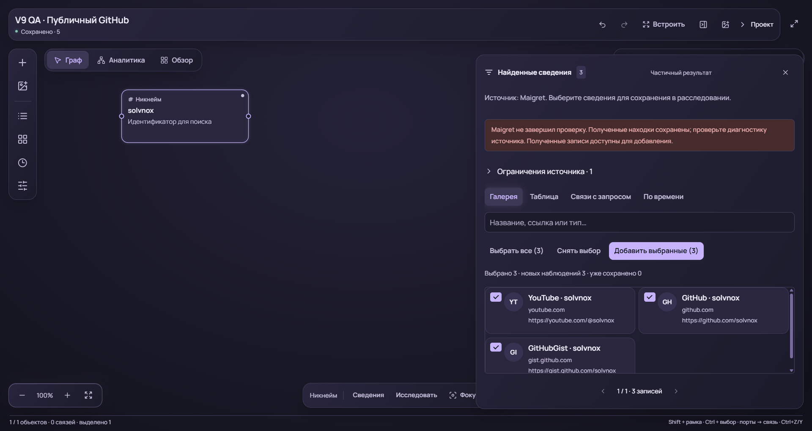
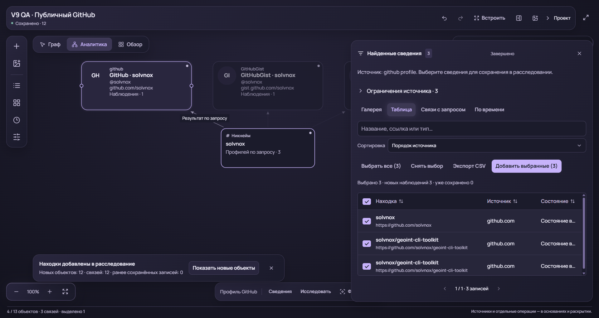
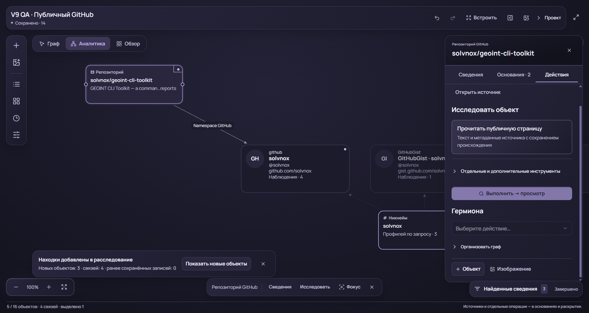
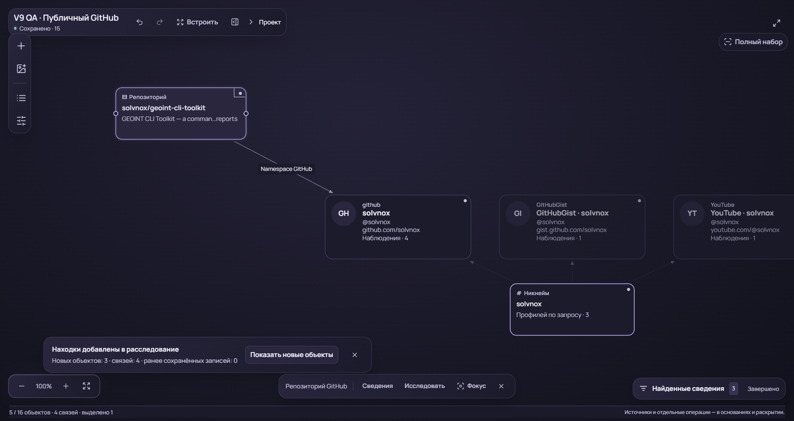
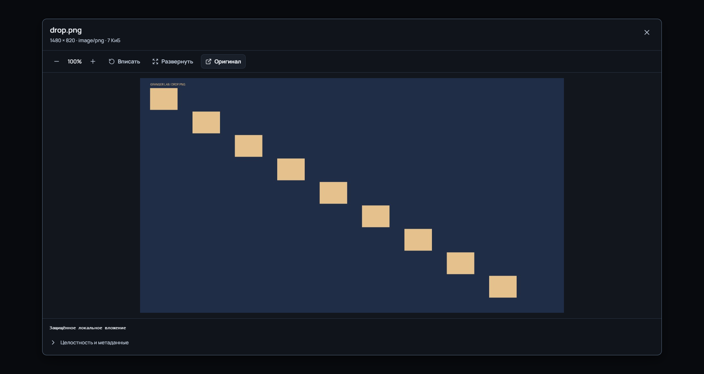
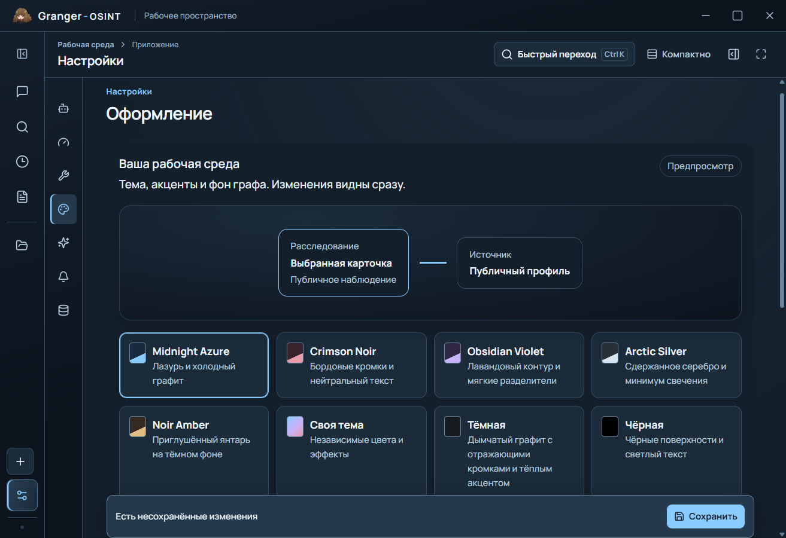
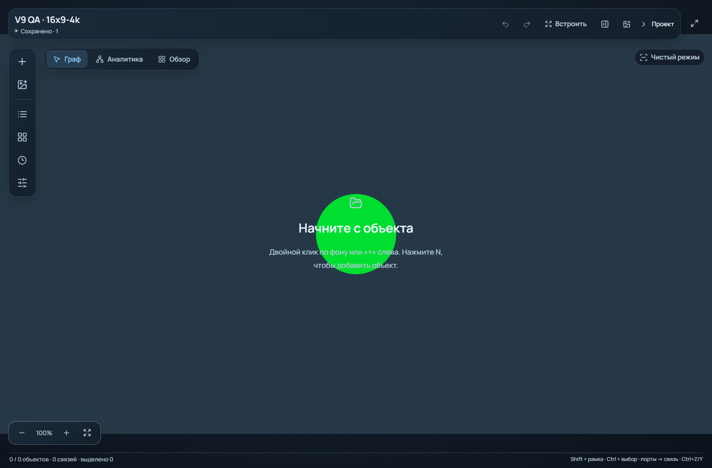

# Granger-OSINT · Visual Refinement V9

## Область и исходное состояние

Работа начата на `main`, HEAD `6837d980438e982a2548dc48c7e169bc4b51a68e`.
Рабочее дерево было чистым. Сохранены копия V8 EXE и контрольные суммы
отслеживаемых файлов, ресурсов и фактического профиля. Единственная удалённая
ветка и ветка по умолчанию — `main`. Новые ветки не создавались.

Исходный EXE имеет SHA-256
`5d21195b416dbc7aec99db8abd50c6cf56159c6e185399f2c734d6c8e778e91c`,
размер 279635267 байт. Он использован для воспроизведения ошибок V8.

Изучены отчёты V6/V7/V8, ResearchCanvas и старый InvestigationWorkspace,
Canvas2D/WebGL2, раскладки и проекции, Qt bridge и UiJob, appearance и
хранилище обоев, AttachmentStore, реестр инструментов, GitHub public sources,
нормализация evidence, CAS и зашифрованные ревизии, сборка и native QA.
Самостоятельный текстовый Canvas, AI-провайдеры и персонаж сохранены.
Полученное задание обрывается в 10.3. После уточнения пользователь поручил
исправлять по имеющемуся тексту. Требования из отсутствующего продолжения
не предполагаются выполненными.

## Установленные причины

### Обои

Контрольный PNG 3840×2160 в V8 превращался в WebP 1920×1080 с quality 80.
При этом соотношение сторон сохранялось и оригинальные байты не менялись.
Средняя поканальная ошибка относительно уменьшенной несжатой контрольной
версии составила 0,758. Это воспроизводит потерю детализации и повторное
сжатие, но не доказывает растяжение фотографии пользователя.

Cover обрезает края при различии пропорций окна и исходника. Stretch меняет
геометрию. Эта разница отражена в редакторе. Личную фотографию пользователя
для диагностики не использовали.

### Двойной клик

В V8 двойной клик по настоящему сохранённому GitHub-профилю Maigret открывал
просмотр аватара. Отсутствующий локальный preview вызывал
`ValueError: Public media has not been fetched` в UiJob и попадал в ErrorCenter.
Процесс продолжал работать, исходный граф оставался цел. Завершение процесса
или renderer в данном воспроизведении не установлено.

### Создание телефона

Номер без международного префикса отклонялся общей ошибкой несовместимого
типа. Заведомо неверная операция оставалась в pending mutations, а promise
формы не завершался. После исправления номера повторная отправка блокировалась.
Теперь конкретная ошибка валидации завершает неуспешную новую операцию и
освобождает форму. Неопределённые ошибки записи/CAS остаются восстанавливаемыми.

### GitHub и сохранение

Для старых профилей Maigret login мог отсутствовать в отдельном атрибуте при
наличии валидного GitHub URL. Строгая Identity-проекция затем скрывала репозитории.
Исправлены typed target resolution и проекция наблюдаемых связей.

При строгой проверке перезапуска V9 обнаружилось ещё одно различие. Кэш
аватаров дописывал `attributes.media` в документ и попадал в последующие
сохранения вида. Узлы, связи и evidence не исчезали, но документ фактов менялся
из-за оформления. Preview теперь хранится в отдельном ограниченном transient
кэше и подмешивается только в представление. Повторный native-source прогон
сравнил факты до и после перезапуска без различий.

### Escape в списках и диалогах

Обход семи разделов настроек в candidate3 выявил реальный отказ клавиатуры,
не обнаруженный frontend tests. Общий Qt QShortcut перехватывал Escape
для fullscreen даже в обычном окне. Radix не получал нажатие. Для web desktop
эта клавиша передана web-иерархии фокуса. Общий обработчик окна уважает
`defaultPrevented`, поэтому сначала закрывается меню/диалог. Native Qt режим
сохраняет собственную обработку fullscreen. Проверка приёмки дополнена
последовательностью Escape с открытым меню и без меню в fullscreen.

### Свежесть frontend внутри EXE

Повторный прогон candidate4/5 обнаружил ошибку процесса сборки. PyInstaller
упаковывал прежний `frontend/dist`, хотя TypeScript исходники и tests уже
изменились. Проверка ресурсов подтверждала совпадение EXE с dist, но не
актуальность dist относительно TSX/CSS. Несколько промежуточных кандидатов
поэтому содержали прежний обработчик Escape и прежние последние стили.

`build_release.py` теперь всегда выполняет `npm run build` перед упаковкой,
без установки зависимостей. Отпечаток src/public/config вычисляется до
компиляции и повторно до выдачи кандидата. Изменение исходников блокирует
выдачу или установку. В receipt записывается отдельный `frontend_build`.
Добавлены проверки фактического вызова компилятора и отказа от продвижения
устаревшего bundle. После пересборки native-source probe подтвердил закрытие
меню без выхода из fullscreen. Неудачные старые кандидаты не устанавливались.

### Viewer под собственным overlay

Нативный media-прогон candidate6 остановился после открытия встроенного
viewer. Его DOM уже содержал кнопку «Оригинал», но она была перекрыта.
Снимок был однотонным. В `workbench.css` viewer имел z-index 171, а более
поздний общий `canvas-workspace.css` поднимал overlay до 200. В итоге контент
оказывался под затемнением. Viewer теперь использует тот же общий уровень 201,
что и остальные диалоги. Native-source probe подтвердил видимость, реальную
доступность кнопки для pointer и открытие оригинала. Media QA теперь требует
не только наличие кнопки в DOM, но и `elementFromPoint` hit, а также отклоняет
однотонные снимки. Это отдельная причина недоступного действия, а не падение
процесса.

### Статусы и сетка галереи

В настоящем Maigret preview положительный статус имел значение `detected`.
Первоначальный фильтр убирал `found/complete`, но оставлял одинаковые плашки
«Есть находки» для `detected`. Фильтр теперь охватывает также известные
положительные статусы наблюдений. Предупреждения, частичные и неизвестные
состояния сохраняются. Для `source_reported` добавлена понятная подпись.

Нативный снимок также выявил наследование старого правила `small {grid-column:2}`
в новом `result-summary`. Оно ставило домен рядом с заголовком и увеличивало
минимальную высоту содержимого. Правило ограничено прежними label-строками,
а галерея использует высоту строк по содержимому. Исправление относится
одновременно к галерее и к title/URL в ResultsTable. Сценарий явно переключает
оба представления, чтобы снимок таблицы не подменял проверку галереи.

## Изменения

### Качество и оформление

Auto выбирает производную 1920/2560/3840 по реальному viewport и DPR с учётом
Cover/Contain. High допускает до 3840 px и WebP quality 95. Original при
нулевом blur возвращает исходные байты JPEG/PNG/WebP без повторного сжатия.
Original/100%, Center и Tile также используют оригинал. При явно выбранном
размытии оригинального качества производная кодируется в PNG без потерь.
EXIF-ориентация учитывается при определении размеров и показе.

Оригинальное хранилище не заменяется производной. Нет искусственного upscale
в backend. Сохранились ограничения импорта 20 МиБ и 24 млн пикселей.
Производные создаются по запросу. Кэш содержит до трёх вариантов с бюджетом
около 96 МиБ оценённой памяти. Один большой активный вариант допускается
самостоятельно. Лимит ответа предотвращает неограниченный data URL.

Масштаб, положение, opacity, dim и blur независимы от качества. Редактор
предупреждает о Stretch. Смена окна, fullscreen и DPR запрашивает подходящий
вариант с debounce. Обычное движение камеры не перекодирует фон. Экспорт
по-прежнему скрывает личные обои по умолчанию.

Матовые поверхности стали исходным спокойным вариантом. Доступны Matte,
Subtle Glass, Balanced Glass, Reflective и Custom. Явные сохранённые настройки
пользователя не сбрасываются. Граница выделения, selection glow, hover glow
и подсветка рёбер регулируются раздельно. При нулевом glow контур и focus
остаются видимы. Одиночное выделение отличается от пунктирного множественного.

### Общие компоненты

Общие `ui.tsx`, `SearchableSelect` и `controls.css` обслуживают настройки,
формы сущностей, инструменты, результаты и другие маршруты. Нативные select
перенесены на существующий Radix menu с поиском, клавиатурой и возвратом
фокуса. Редактируемый список моделей использует ComboBox со свободным вводом.
Checkbox поддерживает mixed/read-only/disabled и отдельный контраст акцента.
Details/Summary используют SVG ChevronDown. Общие scrollbars поддерживают
стандартные CSS свойства и WebKit fallback в Qt WebEngine.

ResultsTable фиксирует колонки, высоту строк и выравнивание. Есть сортировка,
выбор, клавиатура, страницы и пустое состояние. Заголовок и действия
Results Drawer отделены от основного скролла списка. Галерея использует
общую структуру, сохраняет значимые предупреждения и не повторяет положительный
статус на каждой карточке. Clean Mode использует общую вертикаль управляющих
элементов. Полный перечень реализаций хранится в component inventory.

Пользовательский термин исследовательского «полотна» заменён на «Граф».
Внутренние идентификаторы и форматы документов не менялись. Текстовый Canvas
в главной навигации сохранён.

### Активация и mutations

Profile, wallet, document и note открывают сведения. Image/NFT/asset с
изображением открывают viewer. Group сворачивается/раскрывается. Двойной
клик сам по себе не запускает OSINT worker. Ожидаемые ошибки чтения медиа
отображаются локально, без общей аварийной ошибки.

Валидация телефона использует существующий нормализатор и понятную причину.
Международный префикс требуется явно, страна не угадывается. Исправленный
номер можно добавить без перезапуска. Форма защищена от дублирования
отправки и не стирает новый текст, введённый до подтверждения предыдущего
добавления. Восстановленные старые intents не отбрасываются автоматически.

### GitHub

Выполнение `github_profile` в реестре вызывает общий enrichment поверх
существующего public_sources HTTP/cache/rate-limit механизма. Прямой API
public_sources сохраняет совместимость с прежними вызывающими компонентами.
Username извлекается только из typed атрибутов или проверенного GitHub URL.
Display label и ID графа не используются как username.

Официальные публичные endpoints получают профиль, до пяти owner repositories,
до десяти публичных организаций, языки и до трёх релизов для первых двух
репозиториев. Сохраняются metadata, license, URL и provenance. Ограничения
выборки и частичные ответы видны пользователю. Совпадение ника или namespace
не объявляется доказательством личности или владения человеком.

Обычный preview → выбор → добавление создаёт наблюдения, сущности и связи.
Identity View показывает связанные репозитории/организации/релизы, сохраняя
технические узлы в полной модели. Новые карточки размещаются возле профиля,
существующие позиции сохраняются. Ручные инструменты и остальные adapters
не заменены заглушками.

## Основные изменённые файлы

| Область | Файлы |
| --- | --- |
| Обои и appearance | `grangerpet/wallpapers.py`, `grangerpet/appearance.py`, `frontend/src/appearance.ts`, `WallpaperLayer.tsx`, `AppearanceEditor.tsx` |
| Валидация и сохранение | `research_canvas.py`, `research_canvas_bridge.py`, `canvas_capabilities.py`, `frontend/src/useCanvasMutations.ts`, `EntityComposer.tsx` |
| Активация и медиа | `grangerpet/canvas_media.py`, `window_chrome.py`, `frontend/src/App.tsx`, `InvestigationCanvas.tsx`, `ResearchCanvas.tsx` |
| GitHub | `grangerpet/github_enrichment.py`, `public_sources.py`, `agent_tools.py`, `evidence_graph.py`, `frontend/src/graph-model.ts`, `graph-cards.ts` |
| Общие компоненты | `ui.tsx`, `SearchableSelect.tsx`, `ComboBox.tsx`, `ResultsTable.tsx`, `ResearchResults.tsx`, `controls.css`, `canvas-workspace.css` и вызывающие формы |
| Сборка и приёмка | `scripts/build_release.py`, `audit_workspace_release.py`, `qa_ui_v9.py`, `qa_v9_regressions.py`, `qa_github_v9.py`, `qa_wallpaper_v9.py`, обновлённые native сценарии и regression tests |

Имена TSX без префикса относятся к `frontend/src/components`. Общие CSS лежат
в `frontend/src`, а `controls.css` — в `frontend/src/components`. Python файлы
без префикса относятся к `grangerpet`. Полный diff доступен в Git между
начальным HEAD и коммитами V9. Защищённые ассеты персонажа не редактировались.

## Проверки и ограничения

Приёмка выполнена на Windows EXE SHA-256
`78e3b1d1b8b44c99593892df3e773e1e5a7f05353e6c0d3f280b52e6eb025c23`,
279650368 байт. Источники и архив сопоставлены для 171 модуля и 239 ресурсов.
Frontend был заново собран до упаковки. Подробные агрегаты находятся в
`validation/visual-v9/verification.json`, инвентарь — в
`UI_COMPONENT_INVENTORY_V9.md` и `validation/visual-v9/component-inventory.json`.

| Нативный сценарий | Результат |
| --- | --- |
| Базовая приёмка сборочного пути | 22 проверки |
| Семь разделов настроек, custom controls, keyboard, fullscreen, узкое окно | 12 проверок |
| Двойной клик и исправление телефона после ошибки | 5 проверок |
| Двадцать типов объектов, связи, группы, media и перезапуск | 31 проверка |
| Навигация, Ctrl+K, drop/clipboard/path/HTTPS, viewer/original, attach/detach, размеры, effects и масштаб Qt | 25 проверок |
| Живой Maigret → GitHub → добавление → Identity → перезапуск | 9 проверок |
| Геометрия обоев и сохранность оригинала | 16 случаев |

В GitHub сценарии Maigret вернул partial и три настоящих наблюдения.
GitHub-профиль присутствовал в этой выдаче. Enrichment завершился complete
и вернул три записи — профиль, репозиторий и сведения о языках. Публичные
организации и релизы в этой выборке отсутствовали. Их отображение проверено
отдельно контролируемым HTTP fixture. После перезапуска различий в сущностях,
связях и evidence не обнаружено. Source-прогоны не подменяют эти EXE receipts.

Обои проверены для 16:9/4:3/1:1/портретного формата, PNG/JPEG/WebP,
EXIF orientation 6 и текстурного 4K JPEG. DPR был 1,25 и 1,875. На синтетическом
круге максимальная ошибка отношения сторон составила 0,005182, то есть менее
0,52%. Оригинальные байты сохранены во всех случаях. Auto реально выдал
1920, 2560 и 3840 px для соответствующих физических viewport. High выдал
3840 px. Отдельный media-прогон наблюдал DPR 2,5 при QT_SCALE_FACTOR=2.
Размеры 1366/1600/1920/2560 относятся к запрошенным Qt-окнам, а не к четырём
разным физическим мониторам.

Офлайн Python suite после основных исправлений — 2117 passed, 1 skipped,
32 subtests. Пропущен доступ к отсутствующему локальному Ollama, установка
и скачивание модели не предпринимались. Последний frontend suite —
234 passed, 0 failed. Проверки сборочного пути — 37 passed, нативных режимов
окна и передачи Escape — 4 passed.

Промежуточные кандидаты не устанавливались. Первый расширенный media-сценарий
искал прежнюю кнопку в закрытом инспекторе. Следующий workspace-сценарий
выбирал индекс старым Home/Down способом и получал другое направление связи.
Оба сценария переведены на существующие видимые команды и явный выбор
нужного варианта. Candidate3 дополнительно обнаружил реальный Qt Escape bug,
после чего исправлен код приложения. Неудачные прогоны не объявляются успешной
приёмкой финального файла.

Нативные профили изолированы от пользовательских данных и credentials.
Реальный GitHub тест отделён от контролируемых HTTP fixtures. Отсутствие
публичных организаций или релизов не выдаётся за ошибку или найденные данные.
Синтетические wallpaper fixtures проверяют геометрию, не сходство личного фото.
Ни тесты, ни скриншоты не дают гарантии отсутствия любых будущих сбоев.

## Производительность

Сохранённый V8 и финальный V9 последовательно проверены на одной машине,
с отдельными профилями. Использованы 50/100/500/1000/5000 синтетических
объектов и отдельно настоящие сохранённые наблюдения Gansar/Maigret с 424/14
объектами. Последние воспроизводились без новых сетевых запросов и без
изменения evidence. Для V9 дополнительно проверены фон 4K, blur 12, glow 18
и reduced effects на 50/5000 объектах. Все прогоны завершились без оставшихся
собственных процессов.

| Объектов | Paint V8 p50 / p95 / p99, мс | Paint V9 p50 / p95 / p99, мс | Event→paint p95 V8 / V9, мс |
| --- | --- | --- | --- |
| 50 | 3,0 / 4,1 / 4,9 | 3,25 / 6,7 / 12,1 | 20,1 / 16,9 |
| 100 | 3,2 / 4,7 / 5,5 | 3,3 / 4,7 / 5,3 | 21,1 / 19,9 |
| 500 | 3,9 / 7,2 / 8,3 | 4,0 / 7,0 / 7,6 | 11,6 / 20,8 |
| 1000 | 4,4 / 8,9 / 11,2 | 4,2 / 9,1 / 10,7 | 12,1 / 7,6 |
| 5000 | 5,0 / 26,0 / 34,0 | 4,6 / 26,3 / 35,4 | 48,1 / 20,3 |
| Gansar 424 | 1,5 / 2,5 / 3,9 | 1,5 / 2,2 / 3,7 | 15,8 / 7,0 |
| Maigret 14 | 0,6 / 1,0 / 2,4 | 0,65 / 1,2 / 2,5 | 20,1 / 15,7 |

Результат смешанный. Снижение всех хвостовых задержек не установлено.
На 5000 объектах итоговая модель сохранила 5000 узлов, обзор использовал LOD.
Paint p95 составил 28,5 мс с фото, 30,2 мс с blur, 28,8 мс с glow и 31,2 мс
в reduced. Максимум среди этих серий достигал 45,7 мс. Это не постоянные
60 FPS и не гарантия отсутствия микролагов.

В полном прогоне на 5000 объектах медианы RSS суммы процессов составили
около 1,15/1,16 ГБ, private commit — 2,00/1,80 ГБ для V8/V9. CPU машины
при жестах — 10,22/10,42%. RSS включает общие страницы и не равен private
working set. GPU engine/memory counters и остальные случаи сохранены в
`validation/visual-v9/performance.json`; они относятся только к проверенным
PID и не выражают загрузку всей видеокарты.

Первый полный запуск V9 занял 29,314 с против 11,781 с у V8; следующие
запуски того же V9 заняли 11,653–12,480 с. Причина разброса не установлена,
ускорение запуска не заявляется. Это однократные серии, не статистическое
исследование. Event→paint отсчитывается от JS обработчика и исключает паузы
IPC. Обратная величина active frame interval исключает длинные паузы и не
выдаётся за FPS всей сессии.

## Сохранность профиля

При сравнении с начальным снимком обнаружены одно изменение зашифрованного
диалога, один новый зашифрованный pending-файл и исчезновение одного pet lock.
Время записи двух зашифрованных файлов — около 19:31. Канонический launcher
V8 при этом продолжал работать с 18:15. Причина изменения не установлена,
его нельзя приписывать действиям пользователя или замене EXE без свидетельств.
Текущие файлы отдельно скопированы в приватную QA-папку. Откат, удаление или
автоматическое выполнение pending намерений не выполнялись.

Проверка статических защищённых групп совпала для 92 assets, 202 resources,
двух файлов pet runtime, 508 файлов внешних инструментов и пяти конфигураций.
Профиль при установке сравнивается отдельным снимком непосредственно до
замены и после нативного smoke в изолированном профиле. Такой замер не
подменяется сравнением с началом многочасовой сессии.

Установка завершена. Повторные 22 проверки канонического EXE прошли.
В `dist` ровно один файл `Granger-OSINT.exe`, его хеш совпал с принятой сборкой.
За интервал установки проверены 1079 файлов профиля до и после, добавленных,
пропавших и изменённых файлов нет. Recovery-копия V8 и спорных более ранних
изменений остаётся в приватной QA-папке. Секреты не включены в публичные
артефакты. Проверка охватила исходники, ресурсы EXE, application PYZ, Git blobs
и опубликованные агрегаты/PNG без сохранения значений ключей.

## Проверенные снимки EXE

Снимки ниже принадлежат изолированным QA-профилям. Обои и медиавложения
синтетические, GitHub/Maigret данные получены из публичных источников.

