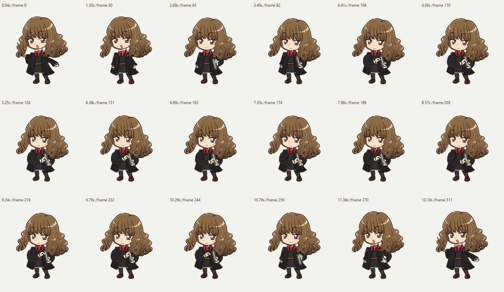
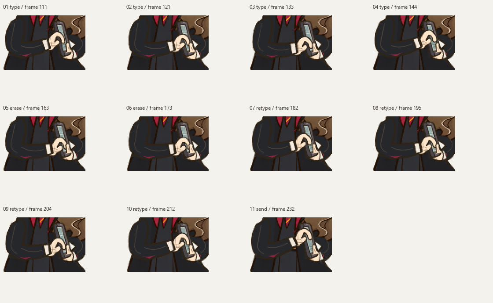
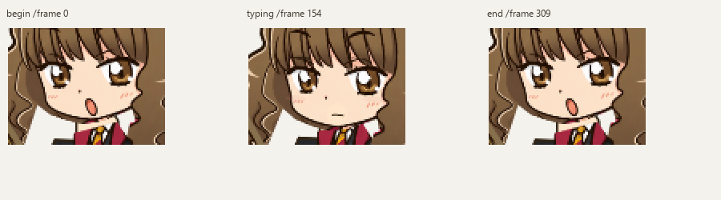

# Phone Solvnox: проверка всей сцены

Все четыре native-клипа сняты с одного Windows EXE:
`2f39ef873aae31c5040ec220e47bd4cca11f993dd98afbeeda3c545fc1a33d4b`.
Они содержат всю 13-секундную сцену без подписей, дорисованных движений
и перестановки кадров. Превью WebP сжаты quality90; исходные lossless/317 PNG
каждого клипа сохранены локально. Размеры ниже — logical sprite px;
физические записи сделаны при DPR1.25, с постоянным alpha-union crop.

| Источник | Полная анимация |
|---|---|
| Настоящий EXE, 100 px | [WebP](native-100/phone_solvnox-v0.webp) |
| Настоящий EXE, 160 px | [WebP](native-160/phone_solvnox-v0.webp) |
| Настоящий EXE, 195 px, основной | [WebP](native-195/phone_solvnox-v0.webp) |
| Windows compositor поверх тестового текста, 195 px | [WebP](native-text-195/phone_solvnox-v0.webp) |
| Production renderer, 100/160/195/256 px, не EXE-захват | [100](source-renderer/phone-100.webp) · [160](source-renderer/phone-160.webp) · [195](source-renderer/phone-195.webp) · [256](source-renderer/phone-256.webp) |

Нативный запрос 256 ограничивается существующим UI до195. Отдельная нативная
проверка 256 не заявляется; диапазон пользовательских настроек сохранён.

Основная нативная раскадровка: извлечение, чтение, набор, пауза, два стирания,
повторный набор, send, смущение и убирание:

Все 11 нажатий из настоящих PNG, увеличены только nearest-neighbour для просмотра:

[Хват и чтение](read-native.png) · [Набор](type-native.png) ·
[Пауза](pause-native.png) · [Стирание](erase-native.png) ·
[Завершающее касание](send-native.png) · [Смущение](delight-native.png) ·
[Убирание](stow-native.png) · [Отвод пальца](hover-native.png).

Фиксированные native crops лица в начале, при наборе и после возврата:

[Все 317 native-кадров](all-native-frames.png) ·
[Все 317 facial crops](all-native-faces.png) ·
[Те же кисти с предметом и без него, production renderer](source-hands-contact-review.png).

Дополнительные production storyboards:
[100](source-storyboard-100.png) · [160](source-storyboard-160.png) ·
[195](source-storyboard-195.png) · [256](source-storyboard-256.png).

Публичные результаты: [identity](identity.json), [preservation](preservation.json),
[другие сцены](non-phone-regression.json), [native contacts](native-contacts.json),
[native runtime](native-runtime.json), [performance](native-performance.json),
[клипы](native-captures.json). Приватные профили, исходные checkpoints и
пользовательские файлы в этот набор не входят.
